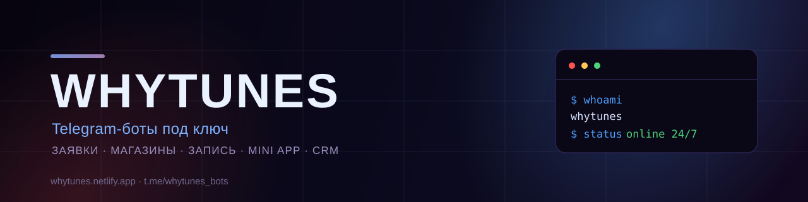
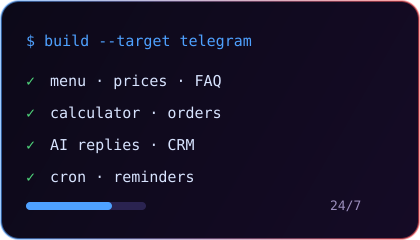
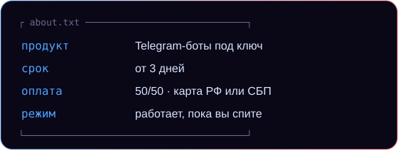

  

 

  

---

### `> whoami`

| <pre>class Studio:     name  = "WHYTUNES"     role  = "Telegram bots & automation"     stack = ["Node.js", "Bot API", "Netlify", "AI"]     motto = "бот работает 24/7 — вы занимаетесь бизнесом"     fuel  = "кофе, дедлайны и чистые логи"     fear  = "unhandled exceptions"</pre> |  |
| :--- | :--- |

### `> cat about.txt`

### `> ./stack.sh`

### `> что делаем`

| 🤖 Боты | 🛍 Магазины | 📅 Запись |
| :--- | :--- | :--- |
| заявки, FAQ, AI-ответы, админка | каталог, корзина, оплата | расписание, напоминания, перенос |

| 📱 Mini App | 🧩 CRM | ⚙️ Автоматизация |
| :--- | :--- | :--- |
| каталог и кабинет внутри Telegram | Google Таблицы, воронка, статусы | напоминания, отчёты, контент |

### `> stats --dark`

  
   
  
   
  

---

  last seen: 04:00 — правлю бота, который отвечает клиентам

